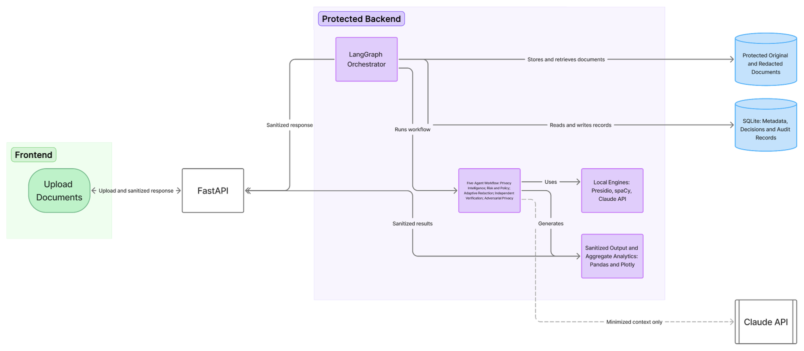

# Multi-Agent Privacy Redaction Review

**Problem statement PS 247** — Generative AI Semester-End Hackathon, Alliance University.

A multi-agent system that finds personal information in documents, judges how risky each
piece of it is, applies an appropriate redaction, and then independently verifies that
what came out is actually safe to release.

> **Status — building toward Review 2.** Done and tested: the Pydantic schemas, the privacy
> knowledge base (JSON + SQLite + policy engine, 64 tests) and the dataset pipeline
> (ai4privacy + PIIMB). In progress: detection and Agent 1. Next: Agents 2–5, LangGraph
> orchestration, evaluation. See [`docs/HANDOFF.md`](docs/HANDOFF.md) for who is doing what.

## The one rule

Original documents and raw identifiers stay inside the protected backend.

What crosses the API boundary is redacted text, entity *categories*, risk scores,
verification findings and aggregate counts. Never an original identifier value.

This applies to log lines and temporary files as much as to HTTP responses. If you are
about to `print()` or log an entity's `value`, don't — log its `entity_id` instead.
`backend/tests/test_no_raw_pii_in_responses.py` exists to keep us honest about this.

## Team

| Member | Registration No. | Area |
|---|---|---|
| Patan Musthakheem | 2023LCSE07AED636 | Architecture, agents, orchestration |
| Pulagampalli Sai Mahima | 2023LCSE07AED635 | Frontend |
| Diddekunta Jagan Mohan Reddy | 2023BCSE07AED200 | Backend API, ingestion, storage |
| Nandha Jyothi E | 2023BCSE07AED156 | Privacy engine and testing |

## Layout

```
backend/privacy_review/
  schemas/          Pydantic contracts between agents. Ask before changing.
  knowledge_base/   policies.json (authoring) -> SQLite (querying) -> policy_engine.py
  datasets/         ai4privacy + PIIMB sampling, label mapping, splits, annotation corruption
  detection/        Presidio + spaCy + custom recognizers            (in progress)
  agents/           the five agents                                  (in progress)
  redaction/        deterministic masking / generalization / pseudonymization
  orchestration/    LangGraph workflow, state, routing
  evaluation/       metrics and reports
  llm/              Claude client - optional, never sees raw identifiers
  ingestion/        .txt / .pdf / annotated .json -> Document, with typed errors
  api/              FastAPI: /review, /upload, /batches/{id}, /health; serves frontend at /ui
  config/           settings from environment / .env
backend/scripts/    prepare_data.py and other runnable entry points
backend/tests/      pytest; tests/fixtures/kb_expected_decisions.json is hand-written
frontend/           HTML + Tailwind + Plotly, no build step
data/               git-ignored. Downloaded samples land here - never commit them.
docs/               Review 1 deck and report, architecture diagram, HANDOFF.md
```

## Getting started

Use Python 3.12, in a folder whose path has no `:` (Python refuses to create a venv there).

```bash
python3.12 -m venv .venv && source .venv/bin/activate
pip install -r requirements.txt
python -m spacy download en_core_web_lg

cd backend
pytest                                  # run the tests
python scripts/prepare_data.py          # download + prepare dataset samples into ../data

cd ..                                   # run the API + frontend from the repo root
uvicorn --factory privacy_review.api:create_app --app-dir backend
# open http://127.0.0.1:8000/ui/
```

A Claude API key is optional. Without one, every agent runs its deterministic path. To
enable LLM reasoning, copy `.env.example` to `.env` and set `ANTHROPIC_API_KEY`.

## Datasets and licensing

| Dataset | Use | Licence |
|---|---|---|
| [ai4privacy/pii-masking-200k](https://huggingface.co/datasets/ai4privacy/pii-masking-200k) | development, validation, test (English, seeded sample) | free for individuals / non-profits; **no redistribution of derived data** |
| [piimb/pii-masking-benchmark](https://huggingface.co/datasets/piimb/pii-masking-benchmark) | independent evaluation: gretel, nemotron-pii and privy tasks only | CC-BY-NC-4.0 |

PIIMB's `ai4privacy-*` tasks are deliberately excluded: they come from the same generator as
our development data, so using them for "independent" evaluation would leak.

## How we work

- `main` stays working. Nobody pushes to it directly.
- Branch per piece of work: `feature/<area>-<short-name>`, e.g. `feature/agents-risk-policy`.
- Open a pull request, get one review from somebody else, then merge.
- If you need to change anything in `backend/app/schemas/`, say so in the group first —
  those are the contracts every other slice is built against.

## Documents

| | |
|---|---|
| Review 1 slide deck | [`docs/review-1/Multi-Agent-Privacy-Redaction-Review.pptx`](docs/review-1/Multi-Agent-Privacy-Redaction-Review.pptx) |
| Review 1 design report | [`docs/review-1/Problem-Analysis-and-Solution-Design-Report.docx`](docs/review-1/Problem-Analysis-and-Solution-Design-Report.docx) |
| Architecture diagram | [`docs/assets/system-architecture.png`](docs/assets/system-architecture.png) |


