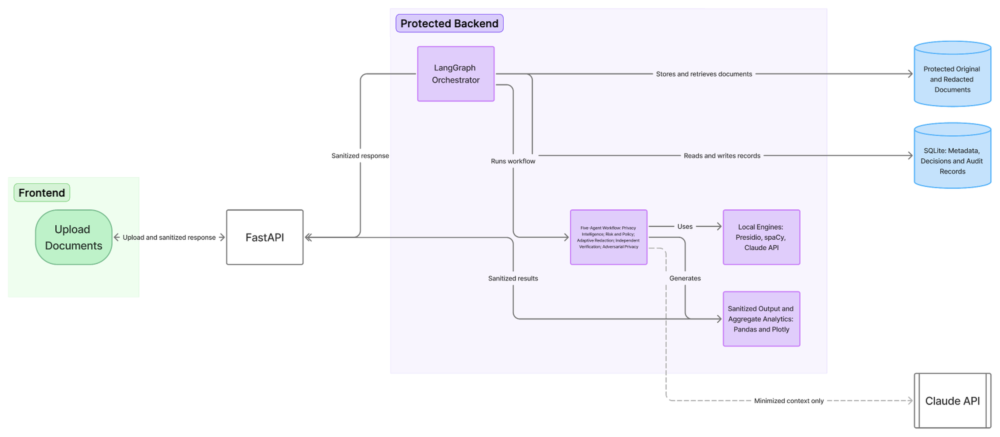

# Document 2: Implementation and Prototype Development Report

**PS 247: Multi-Agent Privacy Redaction Review**
Generative AI Semester-End Hackathon, Alliance University

> **Status: complete for Review 2.** Every number in Section 6 was generated by the scripts in
> `backend/scripts/` and is stored, counts only, in `reports/`. Nothing was estimated.

| | |
|---|---|
| Team | See the team table in the repository README |
| Repository | `pmk456/Multi-Agent-Privacy-Redaction-Reviewer` |
| Review 1 design report | `docs/review-1/Problem-Analysis-and-Solution-Design-Report.docx` |
| Demo script | [`demo-script.md`](demo-script.md) |

---

## 1. Introduction

### 1.1 What Review 2 covers
The prototype turns the Review 1 design into running code. This document covers:
- what has been implemented
- how each part enforces the project's central rule
- how the parts are tested
- what is still to come

### 1.2 The central rule
Original documents and raw identifiers stay inside the protected backend. The only things
that cross the API boundary are:
- redacted text
- entity categories
- risk levels
- redaction strategies
- verification findings
- aggregate counts

This applies to log lines, error messages, the audit database and temporary files as much
as to HTTP responses.

---

## 2. Architecture as implemented



### 2.1 Module map

| Module | Responsibility | Status at time of writing |
|---|---|---|
| `schemas/` | Pydantic contracts between agents and at the API boundary | Done |
| `knowledge_base/` | `policies.json`, SQLite store, policy engine, conflict validator | Done |
| `datasets/` | ai4privacy + PIIMB sampling, label mapping, splits; synthetic cross-document set | Done |
| `ingestion/` | `.txt` / `.pdf` / annotated `.json` → `Document` | Done |
| `api/` | FastAPI service, protected store, audit DB, frontend hosting | Done; serving the live pipeline |
| `frontend/` | Upload, per-document and aggregate views | Done; works against the live API and demo mode |
| `detection/`, Agent 1 | Presidio + spaCy + pattern detectors, annotation validation, clustering | Done and tested |
| Agents 2–5 | Risk/policy, redaction, verification, adversarial | Done and tested |
| `orchestration/` | LangGraph workflow, remediation loop, `run_batch` | Done and tested |
| `evaluation/` | Metrics and reports | Done and tested |

### 2.2 Data flow
1. **Ingest.** A client uploads files or posts JSON. Ingestion validates each file and turns it into a `Document`.
2. **Store originals.** Each original is written to `protected_store/<batch_id>/<doc_id>.<ext>` with owner-only permissions.
3. **Run the pipeline.** `run_batch(documents, batch_id)` returns a `BatchResult`.
4. **Release gate.** At the API boundary, the gate re-validates the result and strips text from every document that is not released.
5. **Record.** The sanitized result and audit rows (ids, statuses and counts only) go to SQLite.
6. **Respond.** The client receives the `BatchResult` and nothing else.

---

## 3. Implementation: agents and policy

### 3.1 Contracts (`schemas/`)
- `Document` is the input contract.
- `BatchResult`, holding `SanitizedDocument` records, is the output contract.
- `PublicEntity`, the entity type that crosses the boundary, deliberately has **no value field**.
- `DetectedEntity.value` is a `SecretStr`, so printing or JSON-dumping an entity shows a mask. The raw text is reachable only through `.raw()`, which keeps every access explicit and greppable.

### 3.2 Privacy knowledge base (`knowledge_base/`)
`policies.json` holds 22 entity policies (identifier class, sensitivity, a strategy for every risk level), seven context rules (CTX-01 to CTX-07, e.g. job title + employer + city escalates to high; a precise date in a document with a direct identifier is reduced to month and year), two narrow exceptions (a dateline date or a standalone place stays readable), linkage weights for Agent 5, and two hard constraints (government IDs, financial accounts and credentials are never kept, generalised or pseudonymised; direct identifiers are never kept).

JSON is the reviewable authoring format; `database.py` loads it into SQLite, and `policy_engine.py` is the only place agents ask what policy says. `validate_knowledge_base()` rejects contradictory policies — duplicate or missing types, a strategy that weakens as risk rises, a forbidden strategy, contradictory rules, exceptions on protected types — and the engine refuses to start on any issue. Unsupported types fail closed (suppress). The tests check the KB against `tests/fixtures/kb_expected_decisions.json`, written by hand from the requirements so that it can catch the KB being wrong; they found two real bugs during development.

### 3.3 Agent 1: Privacy Intelligence
- **Detectors:** Microsoft Presidio (sharing one spaCy `en_core_web_lg` pass), about 60 regular-expression detectors for formats Presidio misses (IMEI, VIN, wallets, GPS, record numbers, credentials in context, Indian Aadhaar/PAN, lowercase job titles after a cue), a job-title gazetteer, and field-name rules for SQL/JSON (`firstName='…'`). Overlaps are resolved by preferring confident format-specific matches over broad NER spans.
- **Annotation validation:** each supplied annotation is *confirmed*, *span mismatch* (including a boundary that splits a word, which is repaired to whole words), *type mismatch* (the more sensitive type is kept), *unconfirmed* (kept and flagged, never dropped) or *invalid* (rejected). Detections the annotator missed are added as *not annotated*. Where detector and annotation disagree, the union of the spans is kept.
- **Fail-safes:** a lone capitalised word that only spaCy calls an organisation or place, and that is not a known city, is marked possibly a first name and masked.
- **Cross-document clustering:** mentions of the same person ("Ananya Rao", "A. Rao") get one cluster id, but only when exactly one full name in the batch fits. Cluster ids are sequential, never derived from the value.
- **Entity graph:** a NetworkX co-occurrence graph over clusters, at sentence and document level.

### 3.4 Agent 2: Risk and Policy
Applies the knowledge base per document and per sentence: base sensitivity, context escalation, then exceptions. Produces one `RiskAssessment` and one `RedactionDecision` per entity, each with an explanation that never quotes the value. Remediation from later rounds can only raise a decision's strategy or narrow a pseudonym's scope, never relax it. The optional Claude step sees tokenized text only and may only raise risk.

### 3.5 Agent 3: Redaction
Deterministic Python, never an LLM. *Mask* writes a typed placeholder (`[EMAIL_ADDRESS]`); *suppress* writes `[REDACTED]`; *generalise* coarsens using KB rules (34 → 30-39, 12/03/1989 → the 1980s, Pune → Maharashtra, Principal Data Scientist → a technology professional) and falls back to mask whenever it cannot produce something strictly less specific; *pseudonymise* gives a consistent `PERSON_01` per person within the batch or document scope. The pseudonym mapping stores only HMAC-SHA256 digests (`protected_store/pseudonyms.sqlite`, mode 0600), never names. Every output carries a segment map back to the original, which lets Agent 4 locate problems in original offsets. It always re-renders from the original text, so remediation never compounds edits.

### 3.6 Agent 4: Verification
Does not trust Agents 1-3: it runs its own detection over the redacted text at a lower threshold (0.30 vs 0.40), re-derives the policy decision for every entity from the KB, and searches the output for every original value. It applies VR-01 to VR-08 (residual PII, original value present, span integrity, transformation format, policy compliance, pseudonym consistency, over-redaction, decision coverage) plus a cross-document check: a value redacted as PII in one document that appears undetected in another is flagged.

### 3.7 Agent 5: Adversarial / re-identification
Reads the redacted output as an attacker would. It is person-centric: each pseudonymised person gets a fingerprint built only from details attached to their own mentions, so a newsletter naming ten people does not merge them. Visible details are weighted by specificity from the KB (generalised values count less; "nurse" much less than "principal data scientist"), uniqueness phrases ("the only…") raise risk, explicit high-risk combinations fire, and a fingerprint shared by a crowd within the batch is downgraded. High risk produces a blocking finding with the cheapest fix: coarsen the most identifying details, or switch a person's pseudonym to document scope so documents can no longer be joined. Documents naming nobody are grouped by shared values. Ground truth is the synthetic dataset in §4.5; results are in §6.5.

### 3.8 Orchestration and remediation loop
`START → intelligence → risk_policy → redaction → verification → adversarial → release`. Blocking findings from Agent 4 or Agent 5 route to `remediate`, which turns them into stricter decisions (raised strategy floors, new entities for things only Agent 4/5 saw, document-scoped pseudonyms, every other occurrence of a leaked value) and loops back to `risk_policy`. At most two rounds (configurable); a round that changes nothing stops the loop. The release gate releases a document only if verification passed and no blocking adversarial finding involves it. A blocked document returns no text at all. `orchestration/runner.py:run_batch()` is the entry point the API imports.

### 3.9 Optional LLM reasoning
Claude is optional — every agent has a complete deterministic path. Defaults keep usage minimal: `claude-haiku-5-5`, low effort, thinking disabled, 1,024 output tokens, and a hard cap of 3 calls per batch. Agent 2 sends tokenized text (`[PERSON_1] works as [OCCUPATION_1]`); Agents 4 and 5 send already-redacted text. Raw text is sent only by Agent 1's optional detection pass, which is off unless `LLM_RAW_TEXT_DETECTION=true`. Responses are parsed into Pydantic models and anything that does not validate is discarded; the LLM may raise a risk but never lower it below the policy floor. Every failure (timeout, rate limit, refusal, malformed output, budget exhausted) returns nothing and the agent continues deterministically. The API key lives in the git-ignored `.env`.

---

## 4. Implementation: ingestion, service, storage and interface

### 4.1 Document ingestion (`backend/privacy_review/ingestion/`)

**Entry points**
- `ingest_bytes(data, filename) -> IngestedDocument` handles a file with exactly one document.
- `ingest_many(data, filename)` handles a `.json` file that may hold a list of documents.
- `IngestedDocument` wraps the `Document` with `format`, `page_count`, `encoding` and `warnings`.

| Format | Handling |
|---|---|
| `.txt` | Decoded as UTF-8 (with or without BOM), then UTF-16 with a BOM, then Windows-1252 with a warning. Bytes that can't be decoded are counted, not quoted. Text is normalised: NUL stripped, `\r\n` → `\n`, Unicode NFC. |
| `.pdf` | PyMuPDF extracts each page's text and joins the pages. A PDF that needs a user password raises `EncryptedPDFError`. A PDF with no text layer (scanned or image-only) raises `ScannedPDFError`; there is no OCR. A PDF with only some pages blank is accepted with a warning. PDFs locked only by an owner password still open. |
| `.json` | One object `{doc_id?, text, annotations?}` or a list of them. The structure is validated, but the text is **not** normalised, because annotation offsets must stay valid. Annotations that are out of bounds or inverted are **kept**: Agent 1 marks them INVALID, and that behaviour is evaluated. |

**Privacy decisions**
- **Filenames are treated as possibly identifying.** For example, `<name>_discharge.pdf` names the patient. The filename is used only to choose a parser. It is never stored on the document, never logged and never put in an error message.
- **doc_id** is the one supplied, or a random UUID4. It is never derived from the content or the filename. A supplied doc_id is restricted to a safe character set, because it becomes a file path.
- **Error messages never quote content.** They report positions instead, such as `documents[2].annotations[0].start must be an integer` or `line 4, column 9`.
- **Limits come from settings:**
  - `MAX_UPLOAD_BYTES` (default 5 MB)
  - `MAX_DOCUMENT_CHARS` (default 200,000)
  - `MAX_FILES_PER_BATCH` (default 20)

**Error codes.** Every error subclasses `IngestionError` and carries a stable `.code`:

| Code | Raised when |
|---|---|
| `empty_document` | The file or text is empty or only whitespace |
| `file_too_large` | The file exceeds `MAX_UPLOAD_BYTES` |
| `document_too_long` | The text exceeds `MAX_DOCUMENT_CHARS` |
| `unsupported_format` | The extension is not `.txt`, `.pdf` or `.json` |
| `corrupt_file` | The file is damaged or not the format its extension claims |
| `encrypted_pdf` | The PDF needs a user password |
| `scanned_pdf` | The PDF has no text layer |
| `malformed_json` | The JSON is invalid or doesn't match the annotated-input structure |
| `invalid_doc_id` | A supplied doc_id has an unsafe format |
| `duplicate_doc_id` | The same doc_id appears twice in a batch |
| `too_many_documents` | A batch holds more than `MAX_FILES_PER_BATCH` documents |

### 4.2 API service (`backend/privacy_review/api/`)

`create_app(run_batch=None)` builds the app. The pipeline is injected, so tests can pass
fakes.

| Endpoint | Purpose |
|---|---|
| `GET /health` | `{"status", "pipeline": "stub" \| "live", "llm"}` |
| `POST /review` | JSON documents → `BatchResult` |
| `POST /upload` | Multipart files → ingestion → `BatchResult`. If any file fails, the response is 422 with `{file_index, code, message}` per file. |
| `GET /batches/{id}` | The stored `BatchResult`, or 404 |
| `/` → `/ui/` | The frontend, served from the same origin (no CORS configuration needed) |

Result endpoints declare `response_model=BatchResult` and nothing else.

**Pipeline stub.** The real `run_batch` hasn't landed yet. Until it does, the app falls back
to a stub that withholds every document: `released=false`, `redacted_text=null`, status
`blocked`. The stub reads only doc_ids. A mock that echoed its input would leak exactly
what it stands in for. When `orchestration.runner.run_batch` becomes importable, the app
uses it automatically.

### 4.3 Protected storage and audit
- **Originals:** `protected_store/<batch_id>/<doc_id>.<ext>`. Files are created with mode `0600` and directories with `0700`. Existing files are never overwritten.
- **`api.sqlite`**, also `0600`, holds two tables:
  - `audit(batch_id, doc_id, status, entity_count, finding_count, created_at)`: never values, never filenames.
  - `results(batch_id, json)`: `BatchResult` JSON only, which is already sanitized.
- `protected_store/` is git-ignored.

### 4.4 Security additions beyond the brief
Each of these closes a specific leak path we found while building the service:

| Leak path | Mitigation |
|---|---|
| FastAPI's default 422 handler echoes the offending input back to the client | A custom handler returns only location, type and message. Unknown request keys are ignored rather than echoed. |
| Exception messages can contain document text, which then reaches logs | An outer middleware logs only the exception's type name and returns a generic 500. Pipeline failures get a dedicated `pipeline_error` response. |
| A pipeline bug could return text for a blocked document | The release gate re-validates every result. It drops `redacted_text` from any document that is not released, and marks inconsistent release decisions as blocked. |
| Unbounded request bodies | Bodies over the limit get 413. Bodies without a Content-Length get 411. |
| A path supplied as doc_id could escape the store | doc_ids are validated with a strict pattern, and paths are resolved and checked against the store root. |
| Batch ids echoed in 404 responses | 404 bodies don't repeat the requested id. |

### 4.5 Synthetic cross-document dataset (ground truth for Agent 5)
`backend/tests/fixtures/synthetic_cross_document.json` is generated by
`backend/scripts/make_synthetic_dataset.py`. The generator is seeded and deterministic, and
all data is fictional. Its format is defined in `privacy_review/datasets/synthetic_schema.py`.

**Composition** (design facts, not metrics):
- 28 documents of 8 types
- a 40-person hidden registry: 9 targets and 31 others
- 208 annotated mentions, each with a hidden `person_id`

**Planted risks**
- **5 re-identifiable targets (k = 1).** For 4 of them, each document shows fewer than three quasi-identifier types, kept out of the sentence that names the person. First-pass policy therefore keeps those values, and only the combination across documents is unique. That is precisely the gap Agent 5 exists to close. The fifth is identified by a document that names nobody; CTX-01 catches it in the first pass.
- **4 controls (k ≥ 3).** Even everything their documents reveal together is shared by at least three registry people, so they must not be flagged.

**Edge cases.** These map to knowledge-base rules:
- name variants of one person
- two people who share a surname
- one email address in two documents
- a document with no name that still identifies someone
- date of birth, postcode and gender in one document
- a medical condition alongside a name
- a nationality stated about a named person
- isolated datelines
- conflicting cities for one person
- a document about an organisation only

**Independence.** k is recomputed in the tests from the registry, not trusted from the
file. The generator derives expected strategies with its own implementation of the
`policies.json` rules, and a test cross-checks every one against the knowledge base's
`PolicyEngine`.

### 4.6 Frontend (`frontend/`)
- Plain HTML with Tailwind and Plotly from CDNs, and no build step. It is served by the API at `/ui/`.
- **Upload view:** multi-file picker and a paste box. A rejected upload shows a per-file error by index. The filename is shown from the browser's own file picker, because the server never sends it back.
- **Per-document view:**
  - release status and reason
  - redacted text, with placeholders and pseudonyms highlighted
  - entity chips by type, coloured by risk (risks and decisions joined on `entity_id`)
  - the strategy applied to each entity
  - verification and adversarial findings, with severity
- **Spans are never displayed.** They refer to the original text, not the redacted text.
- **Aggregate view:** Plotly charts of entities by type, risks by level, strategies and findings, plus released/blocked counts and a cross-document linkage table.
- **Demo mode** loads `frontend/mock/batch_result.json`. The mock is generated from the real Pydantic models with fictional data. A test fails if it drifts from the schema.
- **Rendering safety:** all API data is rendered with `textContent`, never `innerHTML`.

Screenshots for the submission are taken during the rehearsal, in demo mode only (`demo-script.md`).

---

## 5. Testing

| Suite | What it checks |
|---|---|
| `test_knowledge_base.py` | Policies, context rules, exceptions and constraints, against a hand-written expected-decisions fixture |
| `test_ingestion.py` | Every format and failure mode, with fixtures generated in `tmp_path`: text, image-only and encrypted PDFs; UTF-8, UTF-16 and cp1252 text; empty and oversize files; valid and malformed JSON; out-of-bounds annotations kept. Also checks that error messages never quote content. |
| `test_api.py` | Fictional identifiers posted through the stub, a masking fake and a deliberately broken echoing pipeline never appear in responses, audit rows, result rows or captured logs. Also covers file permissions, error indexes and codes, round-tripping through `GET /batches/{id}`, and health reporting. |
| `test_frontend_mock.py` | The demo mock validates and round-trips against `BatchResult` and matches its generator |
| `test_synthetic_dataset.py` | Offsets, determinism, recomputed k, fictional-data rules, edge-case content, and agreement with `PolicyEngine` |
| `test_agent_1.py` … `test_agent_5.py` | Each agent separately: detection formats, annotation statuses, decisions, transformations, injected verification faults, linkage and crowd cases |
| `test_integration.py` | The full LangGraph pipeline: single/multiple, raw/annotated, repeated entities, indirect identifiers, conflicting context |
| `test_adversarial.py` | Deliberately broken agents (wrong "keep", skipped redaction), conflicting KB, malformed input |
| `test_security.py` | No raw value in output, logs, state or reports; blocked documents return no text; retry limits terminate |
| `test_llm_client.py` | Every Claude failure mode returns nothing; budget enforced; tests never enable the API |

**Test run at submission:** `361 passed in 8.21s`

---

## 6. Evaluation

> Generated by `scripts/evaluate_agent1.py`, `evaluate_pipeline.py`, `evaluate_adversarial.py` and
> `evaluate_llm_effect.py`; stored in `reports/`. Dataset-based, synthetic, deterministic and LLM-based
> results are labelled separately. Development decisions were made on the dev split only; test and
> PIIMB were used for reporting.

**6.1 Datasets and splits.** ai4privacy/pii-masking-200k: 400 English examples (seed 247), split 200 dev / 100 validation / 100 test, 1,037 gold spans after label mapping. PIIMB (independent): 300 English examples, 100 each from gretel, nemotron-pii and privy, 1,306 gold spans. PIIMB's ai4privacy-derived tasks were excluded to avoid leakage. Non-identifying labels (amounts, currencies, card issuers, compass directions, honorifics, times) are excluded and listed in `label_maps.py`.

**6.2 Detection (Agent 1, raw text — dataset-based).**

| | Strict P / R / F1 | Relaxed F1 | Caught at all (coverage) | Precision, any type |
|---|---|---|---|---|
| ai4privacy dev | – / – / 0.746 | 0.792 | 93.0% | 0.918 |
| ai4privacy validation | – / – / 0.714 | 0.756 | 91.2% | 0.901 |
| **ai4privacy test** | 0.642 / 0.701 / 0.670 | 0.714 | **92.4%** | 0.876 |
| **PIIMB** | 0.408 / 0.590 / 0.483 | 0.535 | **78.1%** | 0.574 |

PIIMB coverage by task: gretel 83.0%, nemotron-pii 80.4%, privy (SQL/JSON payloads) 54.2%. Per-type figures are in the JSON reports. Precision on PIIMB is low partly because PIIMB leaves many things we detect (nationalities, generic job titles) unlabelled.

**6.3 Annotation validation (30% of annotations deliberately corrupted).**

| Corruption | ai4privacy test | PIIMB |
|---|---|---|
| Out-of-bounds rejected | 100.0% | 100.0% |
| Spurious flagged | 100.0% | 98.7% |
| Wrong type flagged | 92.9% | 100.0% |
| Shifted span flagged | 91.3% | 87.7% |
| Dropped annotation recovered | 92.3% | 73.3% |
| Correct annotation wrongly flagged | 22.9% | 28.9% |
| **Gold spans fully covered after validation** | **98.1%** | **96.5%** |

**6.4 Redaction completeness (full pipeline — dataset-based).** A gold span counts as protected if its original text no longer appears in the released output.

| | Never-keep identifiers protected | All gold spans protected | Leaks: undetected / kept by policy |
|---|---|---|---|
| ai4privacy test | **92.8%** | 84.1% | 15 / 27 |
| PIIMB | **87.5%** | 77.2% | 207 / 89 |

"Kept by policy" is mostly deliberate (a lone city, a dateline, a common job title kept for readability); the datasets count every labelled span as something to remove.

**Verification failure detection (deterministic fault injection).** 361 of 361 injected faults caught across five fault types (dropped entity, wrong "keep", tampered placeholder, generalisation reproducing the value, missing decision); false alarms on 100 clean runs: 0.0%. Caveat: Agent 4 uses the same detector family as Agent 1, so this measures bugs between agents, not detector blind spots — those appear in 6.4.

**Knowledge base (deterministic).** Policy coverage 100.0%; 55/55 checks agree with the hand-written expected file; 0 validation issues.

**6.5 Re-identification on the synthetic set (synthetic).** Agent 5 flagged 4 of 4 people who remain re-identifiable after the first pass, and 0 of 5 controls. Agent 2's first-pass decisions matched the expected strategy for 183/208 mentions (88.0%). Name variants were unified for 23/25 people. **Caveat:** this set was also used to diagnose three fixes (person-centric fingerprints, lowercase job titles, name-variant merging), so it is no longer a blind test; the job-title fix was checked to also improve the ai4privacy validation split.

**6.6 Utility retained.** Share of text still readable (unchanged = 1, generalised = 0.5, blocked document = 0): ai4privacy test 80.9%, PIIMB 80.4%. Documents released: 100/100 and 296/300; mean remediation rounds 0.07 and 0.25.

**6.7 Runtime and LLM usage (LLM-based, small sample).** Deterministic pipeline: 2.3 s for 100 ai4privacy documents and 13.4 s for 300 PIIMB documents. On 30 validation documents, enabling Claude (claude-haiku-5-5, ≤3 calls per document) changed all-span protection from 78.2% to 89.7%, never-keep protection 97.9% → 97.9%, utility 79.9% → 74.9%, and time 1.0 s → 112.1 s, using 66 calls, 51,956 input and 6,796 output tokens (≈ $0.00859 at list price).

---

## 7. Prototype demonstration
See [`demo-script.md`](demo-script.md). The demo uses demo mode and fictional data only.

---

## 8. Limitations and next steps

**Known now**
- No OCR: scanned PDFs are rejected with a clear error.
- No authentication, rate limiting or retention policy for `protected_store/` yet.
- The 0600 permission test is skipped on Windows, which doesn't enforce POSIX mode bits. It must be run on macOS or Linux.
- In the synthetic dataset, k for planted risks is measured against a closed 40-person registry. It shows the mechanism, not real-world population uniqueness.

**Agents and evaluation**
- Raw-text detection drops on unfamiliar data (78.1% on PIIMB vs 92.4% in-domain), weakest on SQL/JSON payloads and on context-dependent categories (occupation, education, beliefs).
- Agent 4 shares Agent 1's detector family, so a value no detector recognises is not caught by verification either; Claude's review is the planned second opinion.
- Ambiguous single-word names are masked as a fail-safe, which over-redacts some genuine single-word organisations.
- Re-identification risk is scored with heuristic specificity weights and a within-batch crowd estimate, not real population statistics.
- The synthetic set was used to diagnose fixes and is no longer a blind test for Agent 5.
- Claude's effect was measured on 30 documents only; it costs latency (~2 s per call).

---

## 9. Contributions
- **Patan Musthakheem:** architecture; privacy knowledge base; datasets and evaluation; Agents 1-5; LangGraph orchestration; Claude integration; tests for those parts.
- **Diddekunta Jagan Mohan Reddy:** document ingestion; FastAPI service, protected store and audit; frontend; synthetic cross-document dataset; this report's skeleton and the demo script.
- **Pulagampalli Sai Mahima:** *[team to confirm]*
- **Nandha Jyothi E:** *[team to confirm]*

---

## Appendix A: Running the prototype

```bash
python3.12 -m venv .venv && source .venv/bin/activate
pip install -r requirements.txt
uvicorn --factory privacy_review.api:create_app --app-dir backend
# open http://127.0.0.1:8000/ui/

cd backend && pytest
python scripts/make_frontend_mock.py        # regenerate the demo mock
python scripts/make_synthetic_dataset.py    # regenerate the synthetic dataset
```
